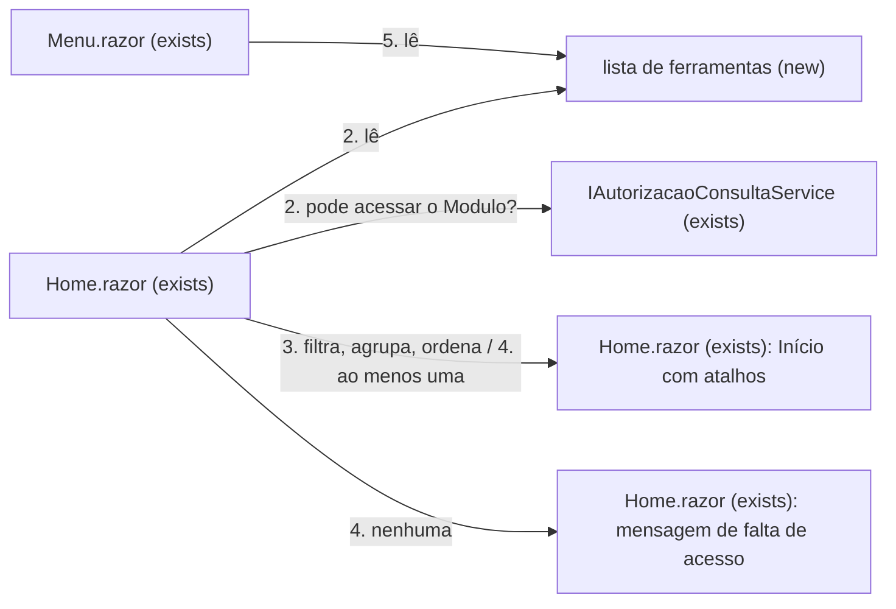

# Página inicial

**Approved**: 2026-11-25 - user: "Aprovado"
**Settled mid-build:** none
**Review:** <written when the review is sent - sent at <HEAD short hash>>
**Fix pass:** <written when the fix pass is made - done - <what it changed, or no changes needed>>

## Problem

O SIAT não tem página inicial. A rota `/`, para onde o login, o logout e a marca do menu
("Ir para o início") levam, só encaminha o usuário para a primeira ferramenta que ele pode usar
(Catálogo, Versões, MailQueue ou AuditLog, nessa ordem). Quem entra no SIAT cai direto no Catálogo,
sem ver o que mais o SIAT oferece. Clicar na marca para "ir ao início" leva de volta ao Catálogo, e a
pessoa não tem uma tela que mostre as ferramentas e o que cada uma faz. O pedido não traz evidências
além dessa descrição: "hoje a home vai direto para sistemas/catalogo".

Quando isto for entregue, quem abrir o SIAT ou clicar na marca vai ver uma página "Início" com um
atalho para cada ferramenta que pode usar, agrupado como no menu e com uma linha sobre o que a
ferramenta faz. A página não leva mais a pessoa para outra tela sozinha.

## Shape

A página reaproveita a verificação de permissão que a `Home.razor` já faz
(`IAutorizacaoConsultaService.PodeAcessarModuloAsync`), a mensagem e o `AvisoVinculoDeRede` de quem
não tem acesso, o `CabecalhoPagina` e a grade `.telas` do `siat.css`. A lista de ferramentas, hoje
repetida no `Menu.razor` e na `Home.razor`, passa a existir num só lugar, lido pelos dois (AD-001).
As regras que mudam o resultado (quais ferramentas aparecem, em que grupo e em que ordem) rodam na
lista compartilhada e na `Home`. A lista é coberta por teste de unidade e a `Home`, por teste de
componente bUnit em `src/Tcmrj.Siat.Test`, onde os testes do repositório já alcançam.

1. O usuário autenticado abre `/` (pelo login, pela marca ou digitando o endereço). A `Home.razor` (exists) recebe a requisição.
2. A `Home.razor` lê a lista de ferramentas (new), com grupo, rótulo, descrição, rota, ícone e `Modulo`, e pergunta ao `IAutorizacaoConsultaService` (exists), para cada `Modulo`, se o usuário pode acessá-lo.
3. A `Home.razor` (exists) mantém as ferramentas permitidas, agrupadas e na ordem da lista, e descarta os grupos vazios.
4. Saída: com ao menos uma ferramenta, a página "Início" com os atalhos. Sem nenhuma, a mensagem de falta de acesso que já existe. Nada é persistido e nenhuma fonte de dados é lida.
5. O `Menu.razor` (exists) passa a montar os grupos a partir da mesma lista de ferramentas (new), com o mesmo resultado de hoje.

**Changes underneath**

| Front | What changes |
| --- | --- |
| domain | A rota `/` era "encaminhar para a primeira ferramenta permitida" e passa a ser "página Início com atalhos". Hoje só dependem dela o login (`returnUrl` `~/`), o logout (volta para `~/`) e a marca do menu, e os três passam a cair na página Início |
| stored data | nada a migrar: o SIAT não guarda dados |
| readers | `Menu.razor` lê a lista compartilhada e deve mostrar exatamente o que mostra hoje (critério 9). Os `HomeTests` que provam o redirecionamento são substituídos, porque a afirmação que eles provam deixa de valer |

Data: none - a página não lê nem grava dados, só verifica permissões a partir das claims do usuário.

## Surface

| Route | In | Out | Status | Who |
| --- | --- | --- | --- | --- |
| `GET /` | nada | página "Início" com os atalhos permitidos (antes: redirecionamento para a primeira ferramenta) | `200`; sem sessão, `302` para `Account/Login` | qualquer usuário autenticado; sem sessão, vai para `Account/Login` e volta para `/`, como hoje |

## Landing

None - não há esquema persistido, dependência nova nem contrato consumido fora do SIAT. Voltar ao
redirecionamento é reverter um commit. A convenção da lista única de ferramentas está em AD-001.

- Nothing else in this change is hard to reverse

## Criteria

### S1: a página Início mostra as ferramentas permitidas, e o menu continua igual (P1)

Quem abre `/` vê os atalhos das ferramentas que pode usar e continua na página.

**Acceptance Criteria**

1. WHEN um usuário autenticado com permissão em ao menos uma ferramenta abre `/` THEN o sistema SHALL mostrar a página com o título (h1) "Início", a aba "Início · SIAT" e a descrição "Sistema Integrado de Apoio Técnico do TCMRio.", e SHALL NOT navegar para outra rota: a URL continua `/` e o histórico não ganha entrada
   - Catálogo, MailQueue e AuditLog → fica em `/`, com 3 atalhos; só Versões → fica em `/`, com 1 atalho (hoje esse usuário é levado para `/sistemas/versoes`)
2. The sistema SHALL mostrar os atalhos agrupados sob os títulos "Sistemas" (Catálogo, Versões) e "Consultas" (MailQueue, AuditLog), nessa ordem de grupos e de itens, e SHALL omitir o grupo que não tem nenhuma ferramenta permitida
   - todas → Sistemas [Catálogo, Versões], Consultas [MailQueue, AuditLog]; só MailQueue → apenas o grupo Consultas, com [MailQueue]; Catálogo e AuditLog → Sistemas [Catálogo], Consultas [AuditLog]
3. IF o usuário não tem permissão numa ferramenta THEN o sistema SHALL NOT mostrar nenhum atalho, rótulo ou descrição dela na página (nem desabilitado)
   - todas menos AuditLog → a página não contém o texto "AuditLog"; só Catálogo → a página não contém "Consultas", "MailQueue", "AuditLog" nem "Versões"
4. The sistema SHALL mostrar, em cada atalho, o rótulo do menu e esta descrição de uma linha:
   - Catálogo → "Onde cada sistema roda: URL, máquina e caminho por ambiente."
   - Versões → "Versão de cada sistema em DSV, HML e PRD, nas duas máquinas de cada ambiente."
   - MailQueue → "E-mails enfileirados pelos sistemas, do mais recente para o mais antigo."
   - AuditLog → "Registros de auditoria (AUDITORIADB · audit.Log), do mais recente para o mais antigo."
5. WHEN o usuário usa um atalho (clique, ou Tab até ele e Enter) THEN o sistema SHALL abrir a ferramenta na mesma aba, e o item dela fica marcado no menu
   - Catálogo → `/sistemas/catalogo`; Versões → `/sistemas/versoes`; MailQueue → `/consultas/mailqueue`; AuditLog → `/consultas/auditlog`
6. IF o usuário não tem permissão em nenhuma ferramenta THEN o sistema SHALL mostrar, sob o mesmo cabeçalho "Início", a mensagem que existe hoje ("Você não tem acesso às ferramentas do SIAT", citando os grupos Sistemas e Consultas do SIA), ou o `AvisoVinculoDeRede` quando a conta de rede não tem matrícula, como hoje, e nenhum atalho
   - nenhuma permissão, com matrícula → a mensagem citando "Sistemas", "catálogo e versões de sistemas", "Consultas", "MailQueue" e "AuditLog"; sem matrícula → o aviso de vínculo de rede
7. WHILE as permissões ainda estão sendo verificadas the sistema SHALL NOT mostrar a mensagem de falta de acesso nem atalhos
   - verificação pendente → nem ".estado" nem atalhos na página; verificação concluída sem permissões → a mensagem aparece
8. The sistema SHALL exigir só usuário autenticado na página Início (`[Authorize]` sem política) e SHALL NOT ler nenhuma fonte de dados nela: só a verificação de permissão por `Modulo`
9. The menu lateral SHALL continuar mostrando os mesmos grupos, itens, rótulos, ícones, rotas e ordem de hoje, a partir da mesma lista de ferramentas da página Início, e SHALL NOT ganhar item "Início"
   - todas as permissões → Sistemas [Catálogo `server`, Versões `git-compare`], Consultas [MailQueue `mail`, AuditLog `list`]; só AuditLog → apenas Consultas [AuditLog]
10. WHEN a janela tem 1280 px ou 375 px de largura THEN a página Início SHALL mostrar todos os atalhos sem rolagem horizontal, e a 375 px cada atalho ocupa a largura do conteúdo
11. The roteiro de validação manual da feature (`.specs/features/pagina-home/quickstart.md`) SHALL trazer os fluxos: entrar no SIAT e ver os atalhos, usar um atalho, clicar na marca e voltar ao Início, e entrar sem nenhuma permissão

## Out of scope

| Excluded | Why |
| --- | --- |
| Busca de sistema na página inicial | o usuário escolheu só atalhos ("Sim, seguir" para a opção 1a); a busca leria o catálogo e exigiria permissão e estados de erro |
| Números ao vivo (total de sistemas, divergências) | mesmo motivo: a página não lê fontes de dados |
| Item "Início" no menu | decidido: a marca já leva ao início |
| Fases futuras do roteiro como "em breve" | decidido: cada fase entra na lista quando for publicada |
| Saudação com o nome do usuário | o nome já aparece no rodapé do menu; o cabeçalho segue o padrão das outras páginas |
| Reescrever `specs/001`, `002` e `003` `contracts/rotas-ui.md` | registram o comportamento de cada entrega; o novo comportamento fica neste plano e em AD-001 |
| Emendar a constituição | a regra "páginas que não exibem dados exigem só autenticação" continua valendo; o exemplo entre parênteses ("a página inicial que só encaminha ou informa a falta de acesso") fica desatualizado, e emendar o texto é decisão da coordenação |

## Assumptions

| Assumption | Chosen default | Rationale | Confirmed? |
| --- | --- | --- | --- |
| O que a página mostra | atalhos das ferramentas, sem dados ao vivo (opção 1a) | user: "Sim, seguir" para as quatro recomendações | y |
| Ferramentas sem permissão | ocultar, como no menu | user: "Sim, seguir" | y |
| Item "Início" no menu | não; a marca já leva ao início | user: "Sim, seguir" | y |
| Fases futuras como "em breve" | não | user: "Sim, seguir" | y |
| Título da página | h1 "Início" e aba "Início · SIAT", com a descrição atual "Sistema Integrado de Apoio Técnico do TCMRio."; o estado sem acesso usa o mesmo cabeçalho | combina com "Ir para o início" da marca e com o padrão "{Título} · SIAT" das outras abas (hoje o `CabecalhoPagina` com "SIAT" daria "SIAT · SIAT") | n |
| Texto dos atalhos | rótulo do menu e a descrição do cabeçalho de cada página; no AuditLog, uma versão fixa sem o número de dias | o usuário já viu esses textos nas páginas; a descrição do AuditLog depende do filtro | n |
| Larguras | 1280 px e 375 px, as mesmas das outras páginas (abaixo de 768 px o menu vira barra superior) | não há captura; o `siat.css` já define essas larguras | n |
| Visual | grade `.telas` do `siat.css` (a de "Telas de exemplo" em `design/index.html`), com o ícone do menu em cada atalho e um título por grupo | reaproveita o sistema de design, sem estilo novo | n |

**Open questions:** none - all resolved or logged above.

## Differences from the source

None - no binding source came with the request

## Sources

- Pedido do usuário em `request.md` - binding - a rota `/` deixa de ir direto para `sistemas/catalogo` e passa a ter uma página própria
- `src/Tcmrj.Siat.Web/Components/Pages/Home.razor` e `Components/Layout/Menu.razor` - comportamento atual, a ordem e os rótulos das ferramentas
- `design/index.html` ("Telas de exemplo") e `design/siat.css` (`.telas`) - non-binding - user did not provide them; padrão visual existente reaproveitado
